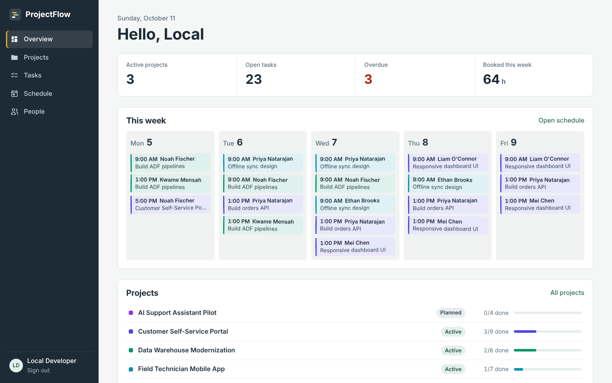
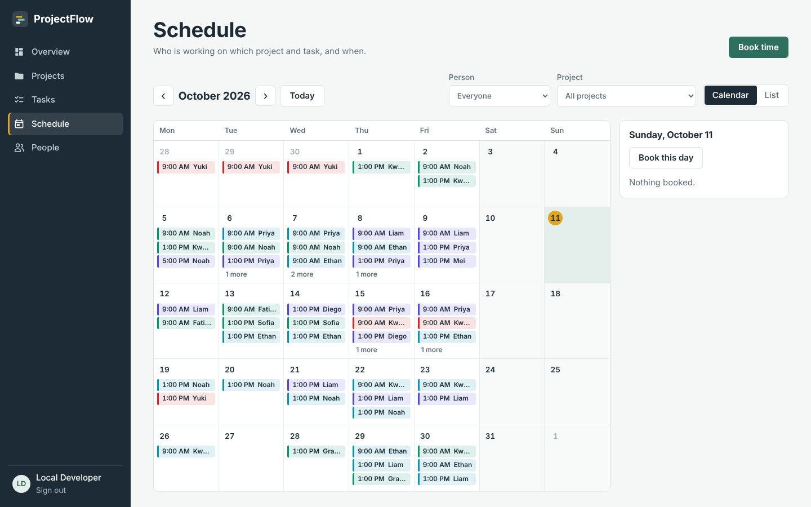
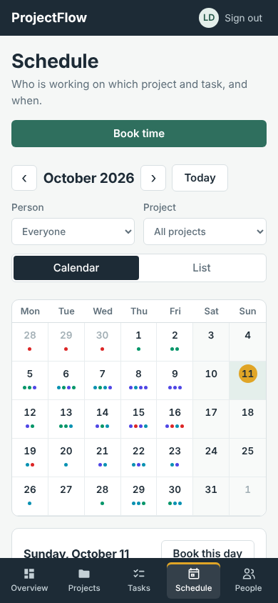
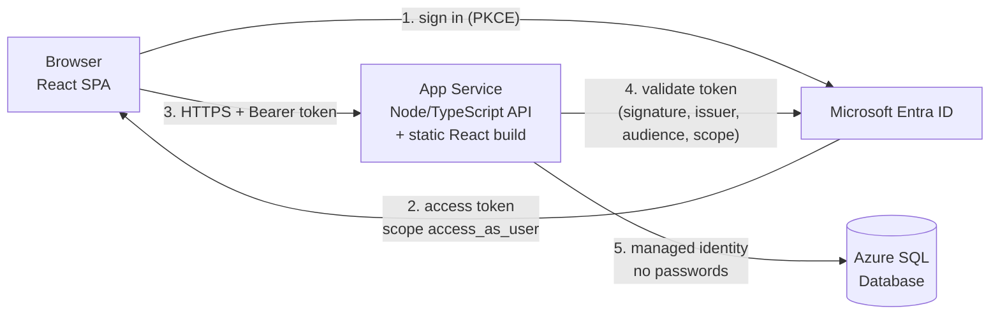
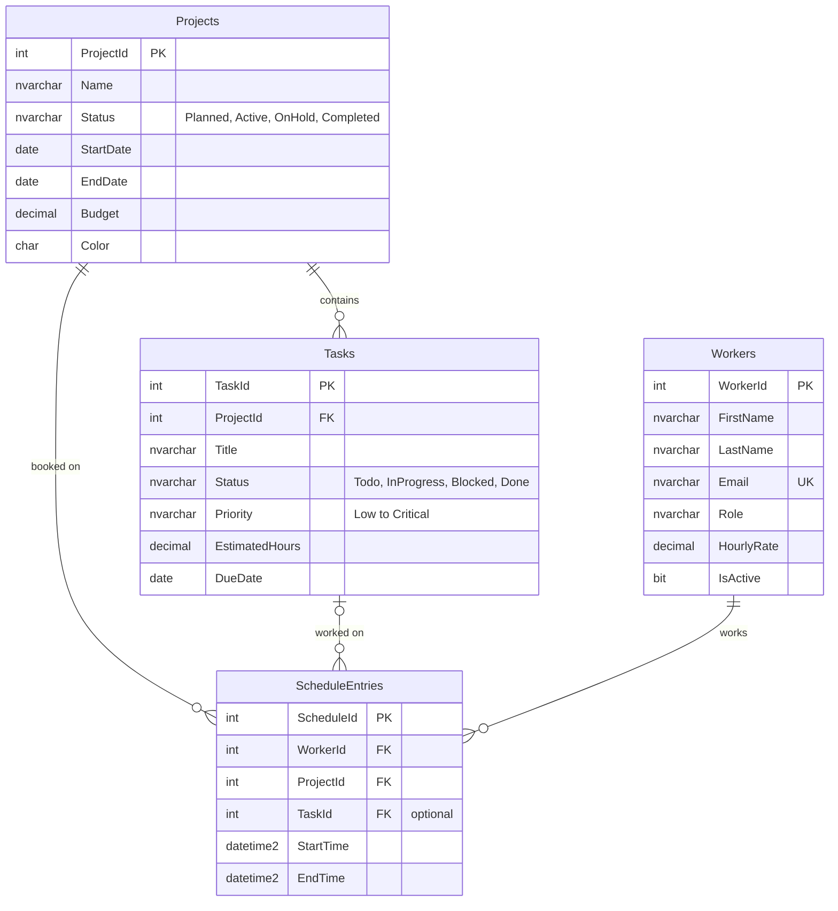

 # ProjectFlow

A full-stack project management website: **projects**, **tasks**, **workers** and a **schedule** of who works on which project and task, with a calendar view and a list view.

| Overview | Schedule (calendar) | Phone |
| --- | --- | --- |
|  |  |  |

| Layer | Technology |
| --- | --- |
| UI | React 19 + TypeScript, built with Vite, responsive down to phone size |
| Sign-in | Microsoft Entra ID (Azure AD) via MSAL.js, auth code flow + PKCE |
| API | Node.js 22 + TypeScript + Express 5 |
| Database | Azure SQL Database, passwordless Entra authentication |
| Hosting | Azure App Service (Linux), one Web App serves the UI and the API |
| CI/CD | GitHub Actions: tests on every pull request, deploy on merge to `main` |



---

## Contents

1. [Try it in 2 minutes (no Azure needed)](#1-try-it-in-2-minutes-no-azure-needed)
2. [Project structure](#2-project-structure)
3. [Data model](#3-data-model)
4. [Set up Azure](#4-set-up-azure)
5. [Run locally against Azure](#5-run-locally-against-azure)
6. [Deploy with GitHub Actions](#6-deploy-with-github-actions)
7. [Security design](#7-security-design)
8. [API reference](#8-api-reference)
9. [Working with Git and GitHub](#9-working-with-git-and-github)

---

## 1. Try it in 2 minutes (no Azure needed)

You need **Node.js 22.9 or newer** (22 LTS) and **Git**.

```bash
git clone https://github.com/<you>/projectflow.git
cd projectflow
npm run install:all
```

Start the API with built-in demo data and sign-in switched off:

```bash
cd api
# macOS / Linux
AUTH_MODE=dev DATA_PROVIDER=memory npm run dev
# Windows PowerShell
$env:AUTH_MODE="dev"; $env:DATA_PROVIDER="memory"; npm run dev
```

In a second terminal start the UI:

```bash
cd web
# macOS / Linux
VITE_AUTH_MODE=dev npm run dev
# Windows PowerShell
$env:VITE_AUTH_MODE="dev"; npm run dev
```

Open http://localhost:5173. Everything works, but data lives in memory and resets when the API restarts. `AUTH_MODE=dev` refuses to start when `NODE_ENV=production`, so it can never leak into Azure.

Run the automated tests:

```bash
cd api && npm test
```

---

## 2. Project structure

```
projectflow/
├── api/                      Node.js + TypeScript REST API
│   ├── src/
│   │   ├── server.ts         starts the app, picks SQL or in-memory data
│   │   ├── app.ts            Express app: security headers, CORS, rate limit, auth, errors
│   │   ├── auth.ts           Entra ID token validation + manager role check
│   │   ├── config.ts         all settings come from environment variables
│   │   ├── routes.ts         REST endpoints
│   │   ├── validation.ts     request validation (zod)
│   │   ├── services/         business rules (scheduling, double-booking)
│   │   ├── data/             Repository interface, Azure SQL + in-memory versions
│   │   └── seed/             AI-generated demo data + schedule generator
│   ├── scripts/              db:migrate, db:seed, db:seed-sql
│   └── tests/                API + auth tests (vitest + supertest)
├── web/                      React + TypeScript UI (Vite)
│   └── src/
│       ├── auth/             MSAL sign-in
│       ├── api/              typed API client
│       ├── components/       layout, forms, dialogs, badges
│       └── pages/            Overview, Projects, Tasks, Schedule, People
├── database/
│   ├── schema.sql            tables, constraints, indexes
│   └── seed.sql              demo data (generated, dates relative to today)
├── infra/                    Azure CLI scripts
├── docs/                     Git guide, AI demo data notes
└── .github/workflows/        CI and deployment
```

---

## 3. Data model



Business rules enforced by the API (`api/src/services/scheduleService.ts`):

- A worker can never be double-booked. Overlapping bookings are rejected with `409` and the clashing bookings are listed in the UI.
- The task of a booking must belong to the booking's project.
- Inactive workers and completed projects cannot be booked.
- One booking is at most 12 hours; end must be after start.
- Deleting a project removes its tasks and bookings in one transaction.

---

## 4. Set up Azure

You need an Azure subscription, the [Azure CLI](https://learn.microsoft.com/cli/azure/install-azure-cli), and permission to create app registrations in Entra ID. Use **Git Bash** or **WSL** on Windows for the `.sh` scripts. Pick a globally unique name, for example `projectflow-jdoe`.

### 4.1 Create the resources

```bash
az login
az account set --subscription "<your subscription>"
./infra/provision.sh projectflow-jdoe centralus
```

This creates a resource group, an Azure SQL server that only accepts Microsoft Entra sign-in (you are the admin), a serverless database that pauses when idle, and a Linux Web App with a managed identity, HTTPS-only and TLS 1.2+.

### 4.2 Register the app in Entra ID

```bash
./infra/entra-apps.sh https://projectflow-jdoe.azurewebsites.net
```

It creates two app registrations: **ProjectFlow API** (exposes the `access_as_user` scope and a `ProjectFlow.Manager` role) and **ProjectFlow Web** (the SPA, with redirect URIs for localhost and Azure). Note the IDs it prints, then give the Web App the API's client ID:

```bash
az webapp config appsettings set -g rg-projectflow-jdoe -n projectflow-jdoe --settings API_CLIENT_ID=<api-app-client-id>
```

<details>
<summary>Prefer the portal? Manual steps</summary>

1. **Entra ID > App registrations > New registration**: name *ProjectFlow API*, single tenant. Under **Expose an API**, set the Application ID URI (`api://<client-id>`) and add the scope `access_as_user` (admins and users can consent). Under **App roles**, add `ProjectFlow.Manager` for users. In **Manifest**, set `"requestedAccessTokenVersion": 2`.
2. **New registration**: *ProjectFlow Web*, single tenant, redirect URI platform **Single-page application**: `http://localhost:5173` and `https://<app>.azurewebsites.net`. Under **API permissions > Add > My APIs > ProjectFlow API**, tick `access_as_user`, then **Grant admin consent**.
3. Optional: **Enterprise applications > ProjectFlow API > Users and groups**: assign people the *ProjectFlow manager* role.
</details>

### 4.3 Set up the database

Allow the Web App's managed identity into the database. In the portal open the database, choose **Query editor**, sign in with Microsoft Entra and run (use your app name):

```sql
CREATE USER [projectflow-jdoe] FROM EXTERNAL PROVIDER;
ALTER ROLE db_datareader ADD MEMBER [projectflow-jdoe];
ALTER ROLE db_datawriter ADD MEMBER [projectflow-jdoe];
```

Create the tables and load the demo data. Either paste `database/schema.sql` and then `database/seed.sql` into the Query editor, or run from your computer (uses your `az login` identity):

```bash
cd api
cp .env.example .env      # then fill in SQL_SERVER, SQL_DATABASE, tenant and API client id
npm run db:migrate
npm run db:seed
```

---

## 5. Run locally against Azure

`api/.env` (copy from `.env.example`):

```ini
AUTH_MODE=entra
AZURE_TENANT_ID=<tenant-id>
API_CLIENT_ID=<api-app-client-id>
DATA_PROVIDER=mssql
SQL_SERVER=projectflow-jdoe-sql.database.windows.net
SQL_DATABASE=projectflow
SQL_AUTH=aad-default
```

`web/.env.local` (copy from `.env.example`):

```ini
VITE_AUTH_MODE=entra
VITE_AZURE_TENANT_ID=<tenant-id>
VITE_SPA_CLIENT_ID=<spa-app-client-id>
VITE_API_SCOPE=api://<api-app-client-id>/access_as_user
```

Then `npm run dev` in `api/` and in `web/`. The API connects to Azure SQL as you (`az login`), the browser signs you in with Microsoft. If the API can't reach SQL, check that your IP is in the SQL server's firewall (Networking blade).

---

## 6. Deploy with GitHub Actions

1. Create an empty repository on GitHub and push this code (see [docs/GIT_GUIDE.md](docs/GIT_GUIDE.md)).
2. Let GitHub deploy without passwords:
   ```bash
   ./infra/github-oidc.sh projectflow-jdoe <github-user>/projectflow
   ```
3. In GitHub **Settings > Secrets and variables > Actions**, add the secrets and variables the script prints, and create an environment named `production` under **Settings > Environments**.
4. Protect `main`: **Settings > Branches > Add rule**, require a pull request and require the **CI** checks to pass.
5. Merge a pull request into `main` (or run **Deploy to Azure** manually from the Actions tab). The workflow builds the UI, tests and builds the API, deploys one package to the Web App, and checks `/api/health`.

Open `https://projectflow-jdoe.azurewebsites.net`, sign in, and you should see the demo data.

---

## 7. Security design

| Concern | How it is handled |
| --- | --- |
| Who is the user? | Microsoft Entra ID sign-in. The SPA uses auth code flow + PKCE; no client secret exists in the browser. Tokens are kept in `sessionStorage`. |
| Is the API call allowed? | Every `/api` request except `/api/health` needs a Bearer token. The API checks the signature against Microsoft's published keys, the issuer (your tenant), the audience (the API registration), expiry and the `access_as_user` scope. |
| Who can change data? | Set `ENFORCE_ROLES=true` to allow writes only for users with the `ProjectFlow.Manager` app role; everyone signed in can still read. |
| Database credentials | None. The Web App uses its managed identity; developers use their own Entra identity. The SQL server has Entra-only authentication turned on, so SQL passwords are disabled. |
| SQL injection | All queries are parameterised (`mssql` inputs); no string-built SQL with user data. |
| Bad input | Every body and query string is validated with zod before reaching business logic; the database has CHECK and FOREIGN KEY constraints as a second line. |
| Browser hardening | `helmet` security headers incl. a Content Security Policy, HTTPS-only + TLS 1.2 on App Service, CORS limited to configured origins. |
| Abuse | Rate limit of 300 requests per minute per IP; JSON bodies capped at 100 KB. |
| Error leaks | Errors return a generic message; details are logged server-side only. |
| Deployment | GitHub Actions logs in with OIDC (no stored Azure password); the deploy identity can only deploy this one Web App. |
| Secrets in Git | `.env` files are git-ignored; `VITE_` values are public by design and hold no secrets. |

---

## 8. API reference

All endpoints are under `/api` and return JSON. Dates are `YYYY-MM-DD`; times are local wall-clock `YYYY-MM-DDTHH:mm:ss`.

| Method | Path | Notes |
| --- | --- | --- |
| GET | `/health` | Public. 200 when the database answers. |
| GET | `/me` | The signed-in user. |
| GET | `/dashboard` | Counts, overdue tasks, hours booked this week. |
| GET, POST | `/projects` | List includes `taskCount` and `doneTaskCount`. |
| GET, PUT, DELETE | `/projects/:id` | Delete also removes tasks and bookings. |
| GET, POST | `/tasks` | Filter with `?projectId=` and `?status=`. |
| GET, PUT, DELETE | `/tasks/:id` | |
| GET, POST | `/workers` | Email must be unique (409). |
| GET, PUT, DELETE | `/workers/:id` | |
| GET, POST | `/schedule` | Filter with `?from=&to=&workerId=&projectId=&taskId=`. POST returns 409 with `details.conflicts` on double-booking. |
| GET, PUT, DELETE | `/schedule/:id` | |

Validation errors return `400` with `details: [{ field, message }]`.

---

## 9. Working with Git and GitHub

[docs/GIT_GUIDE.md](docs/GIT_GUIDE.md) walks through clone, checkout, pull, commit, push, branches and pull requests using this repository. The demo data was written with AI; [docs/AI_DEMO_DATA.md](docs/AI_DEMO_DATA.md) has the prompt and explains how to regenerate it.
