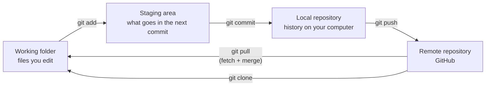
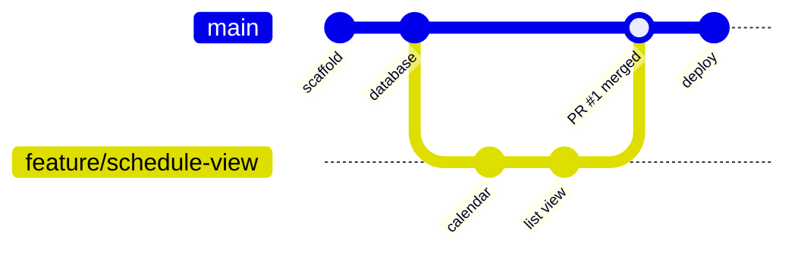

# Git and GitHub, using this project

This guide explains the everyday Git ideas (check in, check out, pull, push, commit, branches and pull requests) by doing them on ProjectFlow. Commands work the same in macOS Terminal, Linux, Git Bash and PowerShell.

## The mental model

Git keeps your work in four places. Most commands just move changes between them.



| Word | What it means |
| --- | --- |
| **Repository (repo)** | The project folder plus its full history (the hidden `.git` folder). |
| **Commit** | A saved snapshot of staged changes, with a message, author and time. Commits are local until you push. |
| **Push** | Upload your new commits to GitHub. |
| **Pull** | Download other people's commits from GitHub and merge them into your branch. `git fetch` downloads without merging. |
| **Branch** | A named line of work. `main` is the line that gets deployed; features happen on their own branches. |
| **Checkout / switch** | Move your working folder to another branch (or commit). `git switch` is the newer, clearer command for branches. |
| **Pull request (PR)** | A request on GitHub to merge one branch into another, with review and automated checks. |

### "Check in" and "check out"

These words come from older centralised tools (TFS, SVN, SourceSafe), where you *checked out* a file to lock and edit it and *checked it in* to save it to the server. Git has no locks, so the mapping is:

| Older term | Git equivalent |
| --- | --- |
| Get latest | `git pull` |
| Check out (start working) | `git clone` once, then `git switch -c feature/x` for each piece of work |
| Check in | `git add` + `git commit` (saved locally) then `git push` (shared) |
| Shelve | `git stash`, or push a work-in-progress branch |

## One-time setup

```bash
git config --global user.name "Your Name"
git config --global user.email "you@example.com"
git config --global init.defaultBranch main
git config --global pull.rebase false   # pull = fetch + merge (simplest to start with)
```

Sign in to GitHub from the command line with [GitHub CLI](https://cli.github.com/) (`gh auth login`) or use Git Credential Manager, which installs with Git for Windows.

## Put this project on GitHub

1. On github.com choose **New repository**, name it `projectflow`, leave it **empty** (no README), and create it.
2. In the project folder:

```bash
git remote add origin https://github.com/<you>/projectflow.git
git push -u origin main
git push origin --all      # also pushes the example branch in the history
```

`-u` links your local `main` to GitHub's `main`, so later you can type just `git push` and `git pull`.

Look at the history you pushed:

```bash
git log --oneline --graph --all
```

You will see `main` plus merge commits where feature branches came in, which is exactly the flow below.

## The everyday flow (GitHub flow)



`main` is always deployable. Every change happens on a short-lived branch and arrives in `main` through a pull request that has passed CI.

### 1. Get the latest `main`

```bash
git switch main
git pull
```

### 2. Create a branch for your change

Name it after what it does: `feature/…`, `fix/…`, `docs/…`.

```bash
git switch -c feature/task-search
```

### 3. Edit, then look at what changed

```bash
git status            # which files changed
git diff              # the exact lines
```

### 4. Commit in small steps

```bash
git add web/src/pages/TasksPage.tsx     # stage one file
git add -p                              # or pick hunks interactively
git commit -m "Add search box to the task list"
```

Good messages say *what* and *why* in the imperative ("Add…", "Fix…"), first line under ~70 characters.

### 5. Push the branch

```bash
git push -u origin feature/task-search
```

### 6. Open a pull request

On GitHub a banner offers **Compare & pull request**, or use the CLI:

```bash
gh pr create --fill --base main
```

The PR template asks what changed and how you tested it. The **CI** workflow runs automatically: API type check, tests, and both builds. If `main` is protected (README section 6), the PR cannot merge until CI is green and, if you require it, someone approves.

### 7. Respond to review

Make more commits on the same branch and `git push`; the PR updates itself.

### 8. Merge and clean up

Press **Merge pull request** (or `gh pr merge --squash --delete-branch`). The **Deploy to Azure** workflow then runs on `main`. Locally:

```bash
git switch main
git pull
git branch -d feature/task-search
```

## When things get in the way

**Pull says you have local changes.** Commit them, or put them aside:

```bash
git stash
git pull
git stash pop
```

**Merge conflict.** Git stops and marks the file:

```
<<<<<<< HEAD
your version
=======
their version
>>>>>>> main
```

Edit the file to the result you want, delete the markers, then:

```bash
git add <file>
git commit             # finishes the merge
```

To update your branch with the newest `main` before opening a PR: `git switch feature/x && git pull origin main`.

**Undo things safely**

| You want to… | Command |
| --- | --- |
| Throw away edits to a file | `git restore <file>` |
| Unstage a file | `git restore --staged <file>` |
| Fix the last commit message (not pushed yet) | `git commit --amend` |
| Undo a pushed commit | `git revert <commit-id>` (adds a new commit that reverses it) |

Avoid `git push --force` on shared branches; it rewrites history other people have.

**Committed a secret by mistake.** Removing it in a new commit is not enough, because it stays in history. Rotate (change) the secret right away, then clean history. This project keeps secrets out of Git with `.gitignore` and uses managed identity and OIDC so there are almost no secrets to leak.

## Practice exercise

1. `git switch -c feature/worker-phone`
2. Add a `Phone` column: `database/schema.sql`, `api/src/domain/types.ts`, `api/src/validation.ts`, both repositories, `web/src/api/types.ts`, and the worker form.
3. Commit in two steps (API, then UI), push, open a PR and watch CI.
4. Merge it and watch the deployment in the Actions tab.

## Cheat sheet

```bash
git clone <url>                 # copy a repo to your computer
git status                      # what changed?
git switch -c <branch>          # new branch
git switch <branch>             # move to a branch
git add <files>                 # stage
git commit -m "message"         # save locally
git push                        # share
git pull                        # get latest and merge
git log --oneline --graph       # history
git branch -a                   # all branches
git stash / git stash pop       # put changes aside / bring them back
```
